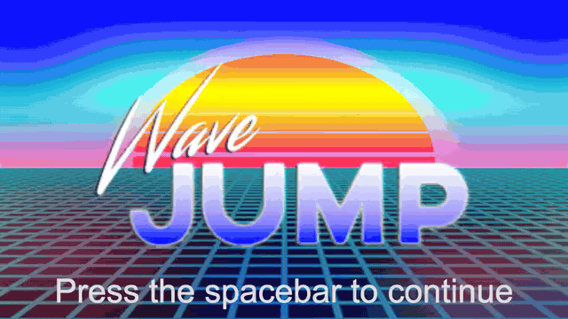

# Wave Jump



Wave Jump is a race for two people sharing one keyboard, made in 48 hours at
Global Game Jam 2018. You each ride a white wave across an 80s sunset grid, and
whoever dives through the checkered gate first gets the point. The wave never
holds still, and you never get the same one twice, so nobody gets to learn the
course.

[Play it at wavejump.joekarlsson.com](https://wavejump.joekarlsson.com/) ·
[Read the full statement](https://www.joekarlsson.com/work/wave-jump/)

## Quick start

Node.js 22 or newer.

```bash
git clone https://github.com/JoeKarlsson/wave-jump.git
cd wave-jump
npm install
npm run dev        # http://localhost:3000, with hot reload
```

## Development

```bash
npx playwright install chromium firefox webkit   # once
npm test           # builds the site and plays it in Playwright, with axe
npm run lint
npm run build      # production build in dist/
npm run images     # redraw the icons and social card (build and run `npx vite preview --port 4173` first)
```

Everything in `assets/` ships with the site. The full-size art and WAV music
in `design/` don't; the game loads WebP and MP3 copies.

To embed the game, give the iframe `allow="fullscreen; autoplay"` and
`allowfullscreen`. Embedded, it starts muted and the speaker button turns sound
on.

The default branch is `develop`. Every push to `master` runs lint and the tests
in GitHub Actions, then deploys `dist/` to GitHub Pages.

## Credits

Made at Global Game Jam 2018 in Minneapolis by
[Joe Karlsson](https://github.com/JoeKarlsson),
[Cal Carlson](https://github.com/calcarlson),
[Daniel Olson](https://github.com/Danielwbolson) and
[Lisa Mabley](https://github.com/lisamabley). Original music and sounds by
Andrew Hill.


## License

MIT. See [LICENSE](LICENSE).
